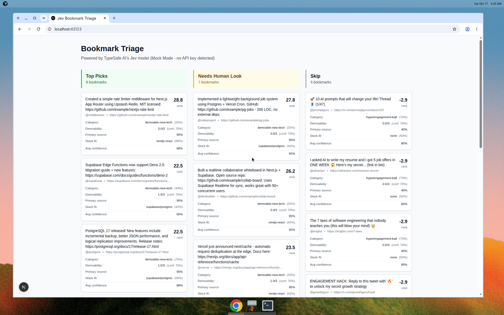

# jev-bookmark-triage

A privacy-first Next.js app that triages saved social posts (bookmarks) using TypeSafe AI's Jev model.

## What is Jev?

Jev is TypeSafe's flagship System One model - built for fast, structured decision-making. Unlike traditional LLMs that generate text, Jev returns typed answers (Choice, Score, Noul) with calibrated probabilities and confidence scores, making it ideal for building reliable automation systems.

## Architecture

This app demonstrates:

- **One systemOne call per bookmark**: All four questions (category, demoability, primary source, stack fit) are asked in a single request
- **Composite scoring**: Multiple signals (category, demoability, etc.) are combined with configurable weights in code
- **Confidence-gated routing**: Items with low average confidence go to "Needs human look" regardless of rank
- **Privacy-first**: All processing happens server-side in a Next.js route handler; nothing is persisted
- **Mock mode by default**: Works without an API key using deterministic mock responses for development and testing

### Files

```
/lib
  types.ts          - TypeScript types for bookmarks, Jev answers, and config
  config.ts         - Ranking weights and confidence threshold (single source of truth)
  jev-client.ts     - TypeSafe SDK wrapper with mock mode fallback
  mock-client.ts    - Deterministic mock client matching Jev's response types
  triage.ts         - Pure ranking/bucketing logic with unit tests
/app/api/triage
  route.ts          - Next.js API route handler (server-side processing)
/app
  page.tsx          - React UI with three-column triage view
/fixtures
  bookmarks.json    - 20 realistic but fictional test posts
/test
  triage.test.ts    - Unit tests for ranking logic
/scripts
  smoke-test.ts     - Smoke test for real Jev API (skips cleanly if no key)
```

## Running the App

### Mock Mode (Default - No API Key Required)

```bash
npm install
npm run dev
```

Open [http://localhost:43123](http://localhost:43123)

The app uses deterministic mock responses. All checks pass:

```bash
npm run typecheck  # TypeScript validation
npm run lint       # ESLint
npm test           # Vitest unit tests
npm run build      # Production build
```

### Real Mode (With TypeSafe API Key)

1. Get an API key from [console.typesafe.ai](https://console.typesafe.ai)
2. Create `.env.local`:

   ```
   TYPESAFE_API_KEY=your-api-key-here
   ```

3. Run the smoke test:

   ```bash
   npm run smoke:real
   ```

   This makes one live call and prints latency + typed answers.

4. Start the dev server:

   ```bash
   npm run dev
   ```

The app will now use the real Jev API (model: `jev-1.14.0`).

## Changing Weights & Threshold

Edit `/lib/config.ts`. All weights and the confidence threshold are in one place:

```typescript
export const DEFAULT_CONFIG: TriageConfig = {
  weights: {
    category: {
      "demoable-new-tech": 10,      // Highest priority
      "how-to/opinion": 4,
      "hype/engagement-bait": -5,   // Negative score
      "off-topic": -10,
    },
    demoability: 8,                  // Weight per normalized score point
    has_primary_source: 5,           // Weight per noul probability point
    stack_fit: {
      "nextjs-react": 6,
      "supabase/postgres": 5,
      "vercel/deploy": 4,
      "ai-agents/automation": 7,
      "none": 0,
    },
  },
  confidenceThreshold: 0.6,          // Avg confidence below this → review
};
```

Rank = (category weight) + (demoability/3 × weight) + (noul × weight) + (stack_fit weight)

Items with rank ≥15 go to "Top picks" (if confidence is high enough).  
Items with rank <0 go to "Skip".  
Everything else (or low-confidence items) goes to "Needs human look".

The unit tests verify that weight changes correctly reorder results.

## Known Limitations

1. **Jev is not infallible**: It can return a plausible but wrong answer with high confidence. Always validate results on real data.
2. **Prompt injection risk**: Untrusted post text could theoretically influence Jev's answers. For production use, consider sanitization or stricter input validation.
3. **Mock mode heuristics**: The mock client uses simple string matching. Results differ from real Jev.
4. **No persistence**: This is a demo. Real use would need a database for bookmarks and triage history.
5. **Rate limits**: The free TypeSafe tier has usage limits. Check [docs.typesafe.ai](https://docs.typesafe.ai) for current quotas.

## Testing

- **Unit tests** (`npm test`): Pure ranking logic, weight changes, confidence thresholds
- **Type checking** (`npm run typecheck`): TypeScript validation
- **Linting** (`npm run lint`): Code style and best practices
- **Smoke test** (`npm run smoke:real`): One live Jev call (requires API key, skips otherwise)

All checks pass in mock mode. The app is built to work end-to-end without external dependencies.

## Screenshot



Three-column layout showing bookmarks sorted into "Top Picks", "Needs Human Look", and "Skip" with per-item probabilities and confidence scores.

## Resources

- [TypeSafe Documentation](https://docs.typesafe.ai)
- [Jev Quick Start](https://docs.typesafe.ai/introduction/quickstart)
- [Confidence-Gated Routing](https://docs.typesafe.ai/patterns/confidence-routing)
- [Composite Scoring](https://docs.typesafe.ai/patterns/composite-scoring)

## License

MIT
